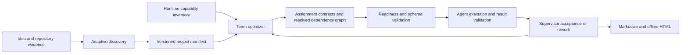

# ProjectForge architecture

## Design goals

ProjectForge separates conversational judgment from deterministic checks. The skill helps the user discover scope and resolve trade-offs. Python helpers inspect the local environment, apply repeatable team and dependency rules, validate manifests, estimate coordination cost, and render documents. No helper silently installs resources, runs discovered code, overwrites project files, or edits global agent configuration.

## Components

| Component | Responsibility |
| --- | --- |
| `SKILL.md` | Runtime-independent discovery and orchestration instructions with progressive disclosure. |
| `references/roles.json` | Versioned expert profiles, role-specific trigger cues, capability expectations, collaboration relationships, and links to selected-role guides. |
| `references/role-guides/` | Selected-role planning rules, domain cues, evidence requirements, boundaries, and handoff criteria. Read only guides for shortlisted roles. |
| `scripts/projectforge.py` | CLI entry point for manifest creation, capability discovery, matching, optimization, validation, estimation, rendering, and diffing. |
| `schemas/` | Draft 2020-12 schemas for versioned project manifests, expert roles, assignment contracts, dependency resolutions, and provider-neutral agent results. |
| `templates/` | Markdown and standalone HTML presentation structure. |
| `examples/` | Representative valid inputs for four project shapes. |
| `tests/` | Standard-library `unittest` suite for script behaviors and safety invariants. |

## Data flow

The manifest is the canonical specification and execution ledger. Agent result files are separately versioned evidence records; the supervisor records their lifecycle and acceptance in the manifest. Commands that apply changes to an existing manifest are serialized per path and compare the file with the snapshot they read; stale updates fail instead of replacing newer changes. Reload the manifest, review the conflict, and rerun the intended operation. A generated document never becomes an alternate source of truth. Team optimization is explainable and advisory: the supervisor resolves context-sensitive decisions, and roster validation is strict about the seven-person ceiling. User choices and evidence take precedence over heuristic recommendations.

## Capability model

Discovery reports a runtime inventory with provenance. It can see local skill directories, frontmatter, agent definition metadata, Codex CLI version, and MCP server names from local config. It does not infer that an installed skill can be invoked in the current session, and it never opens secret configuration values for output. The conversational agent adds capabilities exposed by its active tool surface and marks unavailable information unverified.

Role requirements match to discovered skill names/descriptions, tool names, and custom agents using tags and explainable text matching. A match report lists evidence and status (`available`, `partial`, `missing`, or `unverified`). Metadata discovery is candidate selection; task-specific availability, permissions, and output checks remain separate verification steps. Full skill instructions are read only for shortlisted matches.

## Team model

The supervisor is always present and counts toward the total. `optimize` supports dynamic, manual, and hybrid selection and recommends no more than six specialists. It reports signal-based role relevance, overlap, workstream independence, coordination overhead, context needs, research and integration complexity, handoffs, estimated token use, and review effort. Confirmed project signals and selected requirements score above unresolved facts and questions, which remain visible in the rationale. These values are planning heuristics with visible calculation bases. Requested rosters beyond the limit are surfaced for user discussion; they are never silently truncated or accepted. Each specialist assignment has a contract validated against `schemas/agent-assignment.schema.json`.

## Runtime adapters

The portable manifest, assignment contracts, dependency records, and agent result contract are runtime-neutral. The current adapter recognizes Codex and compatible Agent Skills directories. Codex specialist files use standalone TOML definitions in a target project’s `.codex/agents/`; ProjectForge keeps these as generated output, not active definitions in its own skill package. Runtime-specific concurrency fields are documented in `references/compatibility.md`. Other runtimes get delegation briefs unless their active capabilities are verified.

## Output and security

Markdown is the canonical human-readable specification and HTML is rendered from the same manifest. HTML uses inline styles and scripts, escaped values, no network resources, and print styling. File outputs are written atomically, refuse existing targets by default, and support dry-run. User-provided text is treated as data in HTML and SVG.

## Planned extension points

Keep the manifest versioned and add a registered, loss-conscious migration for every breaking version. The migration registry rejects unknown source and target versions. Add a runtime adapter only when its capability and configuration interfaces are documented. Keep role profiles data-driven so custom roles can be validated without embedding specialist rules in the renderer.
